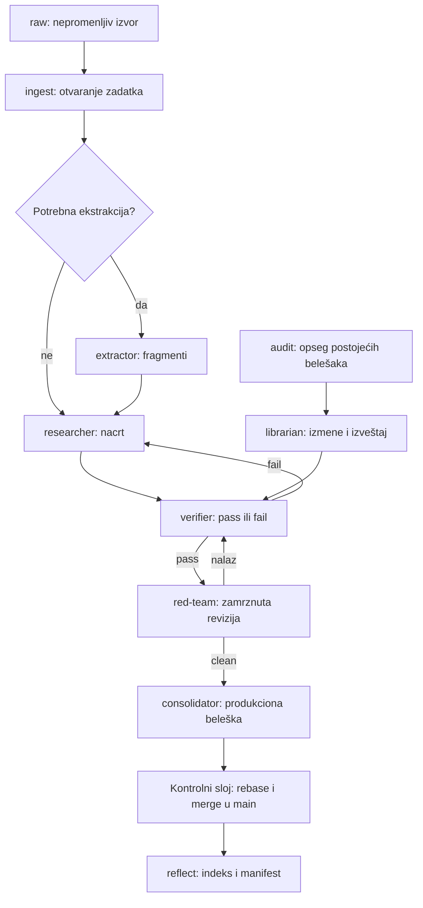

# Arhitektura sistema

[Dokumentacija](README.md) · [Model podataka](MODEL-PODATAKA.md)

## Osnovni princip

Agent 2.0 je crna tabla nad lokalnim fajl sistemom. Agenti ostavljaju artefakte u svojim zonama, dok kontrolni sloj čita trajno stanje zadatka i odlučuje koja faza može da radi. Direktna razmena poruka među modelima nije mehanizam koordinacije. Git čuva verzije i autorstvo, Markdown sadržaj, YAML frontmatter stanje i metapodatke, a JSONL dnevnik događaje.



Za audit, izlaz iz čistog challenge-a ide direktno u kontrolisani merge proverenih izmena. Dijagram skraćuje povratne tokove: odbačeni audit vraća se bibliotekaru, a granica pokušaja može prebaciti zadatak u `blocked`.

## Uloge i odgovornosti

| Uloga | Podrazumevani harnes | Izlazna zona | Odgovornost |
|---|---|---|---|
| extractor | agy | `wiki/drafts/fragments/` | transkripcija bez interpretacije i dokaz porekla |
| researcher | agy | `wiki/drafts/`, bez fragments | izvor → nacrt i veze ka znanju |
| verifier | dsh | `tasks/reviews/` | nezavisna provera i verdikt |
| red-team | dsh | `tasks/challenges/` | napad na tvrdnje na zamrznutoj reviziji |
| librarian | dsh | `wiki/` u audit opsegu, `tasks/audits/` | održavanje postojeće baze |
| consolidator | agy | nove vršne `wiki/*.md` beleške | promocija verifikovanih artefakata |
| agentctl | Node kontrolni sloj | stanje zadataka, događaji, izvedeni artefakti | zakup, faze, komiti i spajanje |

Imena harnesa nisu dokaz različitih modela. Podrazumevano verifier i red-team koriste istog vendora; sistem beleži korelacioni rizik. Mock adapteri nose identitet `mock-<uloga>`.

## Izolovana radna stabla

Svaka uloga radi u worktree-u za zadatak i ulogu, tipično `.worktrees/TASK-103-researcher`, na grani `agent/researcher/TASK-103`. Verifikator grana od istraživača, istraživač od ekstraktora kada je potreban, a konsolidator od verifikatora. Kontrolno stanje i zakup čitaju se iz glavnog korena, jer kopija `tasks/` u worktree-u može biti zastarela.

Faze koje pripremaju sveže radno stablo odbacuju prethodno radno stablo te uloge i polaze od odgovarajuće aktuelne baze. Pre merge-a proveravaju se promenjene putanje i politika zadatka. Indeks i manifest poravnavaju se sa `main`, grana se rebase-uje, a završni merge koristi `--no-ff`. Autorstvo ostaje vidljivo u Git istoriji.

Worktree izoluje promene Git sadržaja; ne daje OS zabranu pristupa drugim fajlovima. Videti [bezbednost](BEZBEDNOST.md).

## Zakup i konkurentnost

Zadatak pod radom ima vlasnika, vreme uzimanja, vreme isteka i token procesa. MCP proverava živi zakup i token pre upisa. `lease.heartbeatMs` postoji u konfiguraciji, ali automatski heartbeat nije implementiran u pregledanom izvršnom kodu. Duži poziv mora imati dovoljno dug zakup ili zasebno obnovljen zakup. Istekle zakupa opozivaju `reclaim` i svaki `runOnce`, uz uklanjanje radnih stabala zadatka.

Mutacije zadatka koriste `.locks/TASK-NNN.lock` i atomski upis fajla. Globalni lock `harness-agy.lock` u okviru kontrolnog korena pokušava da serijalizuje agy pozive. Trenutni file-lock mehanizam može ukloniti zaključavanje starije od 30 sekundi i kada je proces živ; zato ne treba pretpostavljati pouzdanu dugotrajnu globalnu serijalizaciju niti paralelno pokretati više petlji nad istim vault-om.

## Struktura

```text
raw/                         originalni, registrovani izvori
wiki/                        produkcione beleške i izvedeni Index.md
wiki/drafts/fragments/       ekstrakcije, uglavnom u agentskim granama
wiki/drafts/                 nacrti, uglavnom u agentskim granama
tasks/inbox/                 proposed, ready i blocked
tasks/active/                in_progress
tasks/review/                review i verified
tasks/completed/             consolidated
tasks/reviews/               izveštaji verifikatora
tasks/audits/                izveštaji održavanja baze
tasks/challenges/            red-team izveštaji i reprodukcije
tasks/events.jsonl           događaji kontrolnog sloja
.agents/roles/               brief-ovi uloga
.agents/raw-manifest.json    hash osnova izvora
tools/orchestrator/          CLI i biblioteke
tools/mcp/                   lokalni MCP server
tools/config/                mock/real YAML i MCP šabloni
tests/                       jedinični, integracioni i protokolski testovi
scripts/demo.mjs             demo u privremenom skladištu
docs/                        tehnička dokumentacija
.worktrees/ .locks/ .runtime/ lokalni izvedeni radni podaci, ignorisani u Git-u
```

## Mapa modula

| Modul u `tools/orchestrator/lib/` | Odgovornost |
|---|---|
| `config.mjs` | podrazumevane vrednosti, učitavanje YAML-a, apsolutne putanje |
| `pipeline.mjs` | ingest/audit, faze, kontrolna petlja, reflect i status |
| `task.mjs` | šema zadatka, automat, serijalizacija i pronalaženje |
| `store.mjs` | zaključane mutacije, zakup i događaji |
| `lease.mjs` | identitet, token, trajanje i životnost zakupa |
| `worktree.mjs` | izolacija, politika putanja, poravnanje, rebase i merge |
| `git.mjs` | izvršavanje Git komandi i autorstvo |
| `vault.mjs` | beleške, frontmatter, Vikilinkovi, backlinkovi i indeks |
| `lint.mjs` | manifest i provere izvora, belešaka i zadataka |
| `scope.mjs` | obrasci audit opsega |
| `reproduce.mjs` | kloniranje revizije i izvršavanje red-team skripti |
| `yaml.mjs` | ograničeni YAML/frontmatter parser i serializer |
| `fsx.mjs` | atomski upisi, realne putanje, hash, JSONL i file-lock |
| `agents/index.mjs` | izbor adaptera, identitet i kontekst procesa |
| `agents/harness.mjs` | procesi agy/dsh, vreme i prekid |
| `agents/mock.mjs` | deterministički adapteri |
| `agents/prompts.mjs` | brief i stanje zadatka kao prompt |

Spoljni sistem komunikacije, baza podataka, HTTP servis, korisnički interfejs za upravljanje i trajni scheduler nisu deo implementacije.
